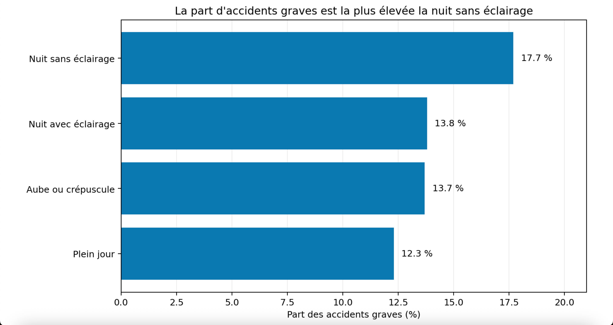
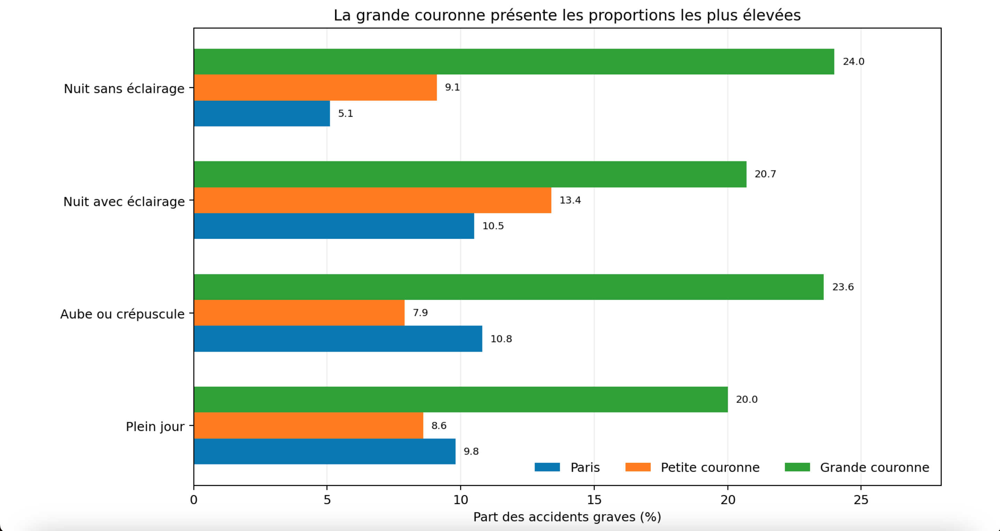
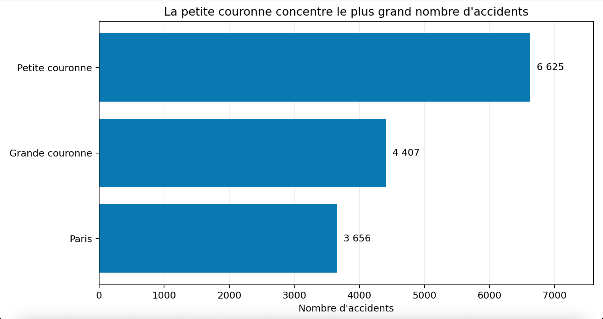

# TP Dataviz – Lisibilité et accidents de la route en Île-de-France

## Partie 1 – Étude des règles de lisibilité (7 à 16)

Introduction

La lisibilité est un élément essentiel dans la création de visualisations de données. Un graphique doit permettre de comprendre rapidement une information sans demander trop d'efforts au lecteur. Les règles 7 à 16 de GoldenViz présentent plusieurs erreurs fréquentes et proposent des solutions pour améliorer la présentation des graphiques.

### Règle 7 – Rendre les axes et les étiquettes faciles à lire

Problème : lorsque les graduations sont trop rapprochées ou que les intitulés sont trop petits, la lecture des axes devient compliquée. Les étiquettes trop longues peuvent également se chevaucher.

Correction : adapter la taille des textes, limiter les graduations et choisir une représentation adaptée. Les barres horizontales peuvent notamment faciliter la lecture des libellés.

Application : pour comparer les départements franciliens, nous privilégierons des barres horizontales afin que les noms restent facilement identifiables.

### Règle 8 – Choisir des couleurs accessibles

Problème : une palette composée de trop nombreuses couleurs ou de nuances similaires rend les catégories difficiles à distinguer, notamment pour les personnes daltoniennes.

Correction : utiliser une palette limitée avec des contrastes suffisants et éviter les associations de couleurs difficiles à différencier.

Application : notre carte utilise plusieurs nuances de bleu pour représenter les concentrations d'accidents. Les accidents mortels sont identifiés en orange afin de les distinguer rapidement.

### Règle 9 – Placer les étiquettes directement sur les données

Problème : une légende séparée oblige le lecteur à faire des allers-retours pour identifier les différentes informations représentées.

Correction : afficher directement les noms et les valeurs à proximité des éléments concernés lorsque cela est possible.

Application : les valeurs sont indiquées directement sur les barres du graphique comparatif. Les informations complémentaires sont également accessibles sur la carte.

### Règle 10 – Éviter les éléments graphiques inutiles

Problème : les effets 3D, les ombres et les grilles trop visibles peuvent surcharger une visualisation et détourner l'attention des données.

Correction : supprimer les décorations qui n'apportent aucune information et conserver une présentation simple.

Application : nous avons privilégié une carte épurée et des graphiques sans effets décoratifs superflus afin de mettre les données au premier plan.

### Règle 11 – Limiter le nombre de catégories

Problème : lorsqu'un graphique présente trop de catégories, il devient difficile de comparer les informations et de repérer les différences importantes.

Correction : regrouper les catégories similaires, utiliser des filtres ou répartir les informations sur plusieurs graphiques.

Application : les cinq modalités initiales de luminosité ont été regroupées en quatre catégories. Les territoires ont également été répartis en trois ensembles géographiques.

### Règle 12 – Organiser les barres selon leurs valeurs

Problème : lorsque les barres sont présentées sans ordre précis, il est moins évident de repérer les valeurs les plus importantes.

Correction : classer les catégories par ordre croissant ou décroissant, sauf lorsqu'un ordre chronologique ou logique doit être conservé.

Application : les catégories du graphique comparatif sont organisées selon leur proportion d'accidents graves afin de faciliter l'identification des écarts.

### Règle 13 – Éviter le chevauchement des points

Problème : un grand nombre de points concentrés dans une même zone peut provoquer des superpositions. Certaines observations deviennent alors invisibles.

Correction : utiliser de la transparence, réduire la taille des marqueurs ou regrouper les observations grâce à des représentations par densité.

Application : plutôt que d'afficher individuellement les 14 688 accidents, nous avons utilisé des hexagones pour représenter leur concentration géographique. Les accidents mortels restent affichés sous forme de points orange.

### Règle 14 – Adapter le nombre de décimales

Problème : une précision excessive rend les valeurs plus difficiles à lire et n'apporte pas nécessairement d'information supplémentaire.

Correction : conserver les nombres entiers pour les effectifs et limiter les décimales pour les taux et les pourcentages.

Application : les nombres d'accidents sont affichés sous forme d'entiers et les pourcentages sont arrondis à une décimale.

### Règle 15 – Simplifier l'affichage des dates

Problème : un axe contenant trop de dates peut devenir surchargé et rendre les évolutions temporelles difficiles à suivre.

Correction : réduire le nombre de graduations et utiliser des formats plus courts, par exemple en affichant uniquement les mois.

Application : cette règle n'a pas été directement utilisée dans nos visualisations, car l'analyse porte sur une seule année et se concentre sur les conditions de luminosité plutôt que sur une évolution temporelle.

### Règle 16 – Privilégier la simplicité visuelle

Problème : vouloir représenter trop d'informations dans un même graphique peut rendre le message principal difficile à identifier.

Correction : sélectionner les informations pertinentes et attribuer un objectif précis à chaque visualisation.

Application : nous avons séparé l'analyse géographique de l'étude de la gravité selon la luminosité. Chaque graphique possède ainsi un objectif distinct.

Bilan de la première partie

L'étude des règles de lisibilité montre qu'une visualisation efficace doit avant tout faciliter la compréhension des données. Les choix de couleurs, de formes, de légendes et de catégories ont donc une réelle importance. Ces principes ont été pris en compte dans la réalisation de notre carte et de nos graphiques comparatifs.

## Partie 2 – Analyse des accidents de la route en Île-de-France en 2025

Données

Base BAAC 2025 (data.gouv.fr). J’ai choisi d’étudier les accidents survenus en Île-de-France et j’ai utilisé deux fichiers

caract-2025.csv — un accident par ligne
usagers-2025.csv — une personne par ligne
Nettoyage

55 093 accidents recensés en France, dont 14 760 en Île-de-France
Conversion des coordonnées lat et long en valeurs numériques, en remplaçant les virgules par des points, puis projection en Lambert 93
Suppression de 72 accidents dont les coordonnées se situaient en dehors de leur département
Gravité de l’accident déterminée à partir de la victime la plus gravement touchée. Un accident est considéré comme grave lorsqu’il comporte au moins un tué ou un blessé hospitalisé
Luminosité regroupée en 4 catégories au lieu de 5, en réunissant les deux catégories correspondant à la nuit sans éclairage
Au final, l’analyse porte sur 14 688 accidents, dont 252 mortels et 1 929 graves.

### Carte des accidents corporels en Île-de-France en 2025

À gauche, on retrouve l’ensemble de l’Île-de-France et à droite un zoom sur Paris et la petite couronne. La couleur représente le nombre d’accidents par hexagone, avec une échelle logarithmique. Les points orange correspondent aux accidents mortels.

### Gravité des accidents selon les conditions de luminosité

Cette visualisation compare la proportion d’accidents graves selon les conditions de luminosité. La nuit sans éclairage présente la proportion la plus élevée, avec 17,7 %, contre 12,3 % en plein jour.

### Comparaison de la gravité des accidents selon les zones géographiques

### Interprétation

| Zone | Accidents | Accidents mortels | Part d'accidents graves |
|---|---:|---:|---:|
| Paris | 3 656 (24,9 %) | 32 (12,7 %) | 10,0 % |
| Petite couronne | 6 625 (45,1 %) | 63 (25,0 %) | 9,6 % |
| Grande couronne | 4 407 (30,0 %) | 157 (62,3 %) | 21,0 % |

Les accidents sont principalement concentrés à Paris et en petite couronne, qui représentent ensemble 70 % des accidents. La carte montre notamment une forte concentration dans Paris.
La grande couronne concentre toutefois 62,3 % des accidents mortels. La part d’accidents graves y atteint 21 %, contre environ 10 % à Paris et en petite couronne.
La Seine-et-Marne compte 1 213 accidents et 62 accidents mortels, ce qui représente le nombre le plus élevé parmi les départements étudiés.
Une hypothèse serait que les vitesses de circulation sont plus élevées hors agglomération, ce qui pourrait entraîner des chocs plus violents. Cependant, les données utilisées ne permettent pas de vérifier cette explication, car elles ne renseignent pas directement la vitesse des véhicules.
Concernant la luminosité, les accidents survenus de nuit sans éclairage présentent une part d’accidents graves de 17,7 %, contre 12,3 % en plein jour. Toutefois, 59 % de ces accidents ont lieu en grande couronne. À l’intérieur de cette zone, la part d’accidents graves passe de 20 % en journée à 24 % la nuit sans éclairage. La localisation semble donc également jouer un rôle important dans les différences observées.

### Règles de lisibilité appliquées

- **7** — Utilisation de barres horizontales pour faciliter la lecture des libellés.
- **8** — Utilisation d’un dégradé de bleus et d’une couleur orange pour distinguer les accidents mortels.
- **9** — Affichage direct des noms et des valeurs sur les visualisations afin de faciliter leur interprétation.
- **10** — Suppression des éléments graphiques inutiles, comme les grilles et les cadres.
- **11** — Regroupement des catégories de luminosité de 5 à 4 et des départements en 3 grandes zones.
- **12** — Classement des barres selon la part d’accidents graves.
- **13** — Utilisation d’hexagones pour représenter les concentrations d’accidents plutôt que de superposer les 14 688 points.
- **14** — Utilisation de nombres entiers et de pourcentages arrondis à une décimale.
- **16** — Attribution de titres explicites aux graphiques pour faciliter la compréhension des résultats.
